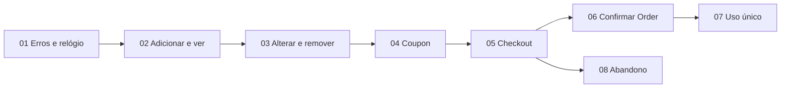

# Blueprint do Carrinho

Quebra do [FRD do Carrinho](frd-carrinho.md) em tickets verticais (tracer bullets). Cada ticket atravessa as camadas que lhe cabem (banco, contrato, API, frontend e testes nas seams do FRD), termina testado e funcionando, e atualiza o README com o que acrescenta.

## Tickets

| # | Ticket | Bloqueado por | Entrega |
| --- | --- | --- | --- |
| 01 | [Prefactor: erros de domínio e relógio injetado](issues/01-erros-de-dominio-e-relogio.md) | — | Erro de domínio mapeado para o envelope; relógio como dependência da montagem do app |
| 02 | [Adicionar ao Cart e ver o Cart](issues/02-adicionar-e-ver-cart.md) | 01 | Tabelas de Cart, criar e ler Cart, adicionar item, Shopper id, `#/carrinho` |
| 03 | [Alterar e remover Cart Items](issues/03-alterar-e-remover-itens.md) | 02 | Alterar quantidade, remover item, último item → Vazio |
| 04 | [Aplicar Coupon](issues/04-aplicar-coupon.md) | 03 | Tabela de Coupons, aplicar/trocar/remover, aritmética do Discount |
| 05 | [Checkout e voltar a editar](issues/05-checkout-e-voltar-a-editar.md) | 04 | Tabela de transições, itens travados no checkout, visão de checkout |
| 06 | [Confirmar o Order](issues/06-confirmar-order.md) | 05 | Transação de confirmação (ADR 0009), Order, página de confirmação |
| 07 | [Coupon de uso único por Shopper](issues/07-coupon-uso-unico-por-shopper.md) | 06 | `COUPON_ALREADY_USED` ao aplicar e ao confirmar, índice único parcial |
| 08 | [Abandono do Cart](issues/08-abandono.md) | 05 | Abandono explícito e por 24 h sob demanda, "Seu carrinho expirou" |

## Grafo de dependências

## Ordem de execução

Trabalha-se a **fronteira**: qualquer ticket cujos bloqueadores estejam concluídos.

1. 01
2. 02
3. 03
4. 04
5. 05
6. 06 e 08 (independentes entre si; qualquer ordem)
7. 07 (depois de 06)

Cada ticket é implementado numa sessão limpa (`/clear` entre tickets), por TDD nas seams acordadas no FRD, terminando com um commit no `main` que fecha o ticket.

## Notas sobre as dependências

- 04 depende de 03 só pela regra "remover o último item também remove o Coupon"; 05 depende de 04 só para testar o Coupon editável durante o checkout. As arestas foram mantidas para uma cadeia linear, já que o trabalho é sequencial.
- 07 foi separado de 06 para manter a confirmação dentro de uma janela de contexto: 06 entrega a transação e o Order; 07 acrescenta a regra de uso único e sua corrida.
