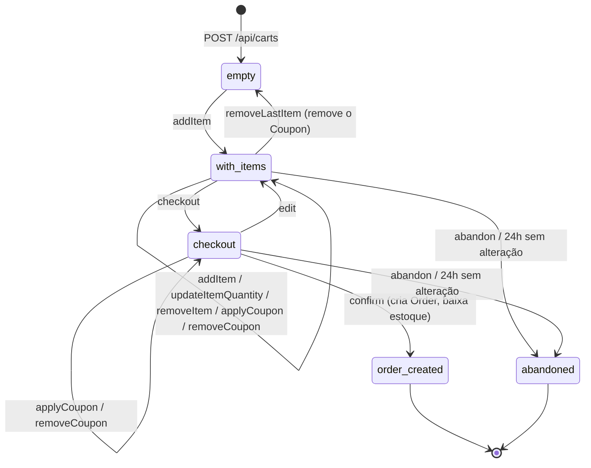

# FRD do Carrinho (engenharia reversa)

Documento reconstruído **apenas a partir do código**: `backend/` (rotas, Services, Repositories, máquina de estados, schema Drizzle, migrations SQL, handler de erros, scripts de seed), `shared/` (contratos TypeBox), `frontend/` (páginas, Domain, cliente HTTP, `localStorage`), `e2e/` (Playwright), testes de integração e unitários, `docker-compose*.yml`, `Makefile`, `package.json` e o `nginx.conf`. Não foram lidos `docs/` (exceto para gravar este arquivo), `GLOSSARY.md`, `README.md`, `CODING_STANDARDS.md`, `CLAUDE.md`, o enunciado do projeto nem o histórico do git. Comentários no código que citam seções de um "FRD" ou de "ADR" foram ignorados como fonte de requisito: cada regra abaixo descreve o que o código faz, com referência `arquivo:linha` para as não óbvias. A aplicação não foi executada; o comportamento foi inferido do código e confirmado pelos testes existentes.

## Problem Statement

Um comprador anônimo (o **Shopper**) navega por um catálogo de Products com preço e estoque e precisa juntar produtos num carrinho, ajustar quantidades, aplicar um cupom de desconto, revisar e confirmar a compra, gerando um pedido (**Order**) que baixa o estoque. Não há login: o comprador precisa ser reconhecido entre recarregamentos da página só pelo navegador. O sistema precisa impedir que o carrinho seja alterado durante a revisão, que o estoque seja vendido duas vezes em compras simultâneas, que um cupom seja usado mais de uma vez pelo mesmo comprador, e precisa encerrar carrinhos esquecidos.

## Solution

Uma API REST (Fastify + PostgreSQL via Drizzle) expõe o recurso **Cart** com uma máquina de estados de cinco estados (`empty`, `with_items`, `checkout`, `order_created`, `abandoned`). O Shopper é identificado por um UUID gerado no navegador e guardado em `localStorage`; o id do Cart corrente também. Cada alteração do Cart passa pela tabela de transições; o dinheiro (Subtotal, Desconto, Total) é sempre calculado no servidor em centavos inteiros. A confirmação (`checkout → order_created`) roda numa única transação que revalida o Coupon, baixa o estoque com update condicional e cria a Order com cópias do preço e do Coupon. O abandono acontece por ação explícita ou, sem job agendado, de forma preguiçosa: qualquer requisição a um Cart parado há 24 horas ou mais o abandona antes de fazer qualquer outra coisa. Um frontend sem framework (Web Components + rotas por hash) oferece catálogo, carrinho e página de confirmação do pedido, em português.

## User Stories

### Identidade e ciclo de vida do Cart

1. Como Shopper, quero ser reconhecido pelo meu navegador sem criar conta, para que meu carrinho sobreviva a um recarregamento da página.
2. Como Shopper, quero que meu primeiro "Adicionar ao carrinho" crie o carrinho automaticamente, para não ter de iniciá-lo à parte.
3. Como Shopper, quero ver o estado do meu carrinho ("Vazio", "Com itens", "Em checkout", "Pedido criado", "Abandonado"), para saber o que posso fazer com ele.
4. Como Shopper que limpou os dados do navegador, sou tratado como um novo comprador, com um carrinho vazio.
5. Como Shopper cujo carrinho já virou pedido ou não existe mais, quero que a próxima adição comece um carrinho novo sem erro.

### Itens

6. Como Shopper, quero adicionar um Product com uma quantidade de 1 a 99 a partir do catálogo.
7. Como Shopper, quero que adicionar de novo um produto que já está no carrinho some à quantidade existente, mantendo o preço unitário do momento da primeira adição.
8. Como Shopper, quero que o preço unitário de um item fique congelado no valor de quando entrou no carrinho, mesmo que o preço do produto mude depois.
9. Como Shopper, quero alterar a quantidade de um item (substituindo-a) e remover itens.
10. Como Shopper, quero ser impedido de pedir mais unidades do que o estoque atual do produto, ou mais de 99 unidades de um mesmo produto.
11. Como Shopper, não quero conseguir adicionar um produto esgotado (botão desabilitado e selo "Esgotado").
12. Como Shopper, quero ver os itens na ordem em que entraram no carrinho, com nome, preço unitário, quantidade e subtotal do item.
13. Como Shopper, ao remover o último item, quero que o carrinho volte a ficar vazio (e perca o cupom).

### Coupon

14. Como Shopper, quero aplicar um cupom digitando o código em qualquer combinação de maiúsculas/minúsculas.
15. Como Shopper, quero que aplicar outro cupom substitua o atual (no máximo um por carrinho).
16. Como Shopper, quero remover o cupom aplicado; remover quando não há cupom não deve dar erro.
17. Como Shopper, quero ver o desconto percentual (arredondado para baixo ao centavo) ou fixo (limitado ao Subtotal, nunca deixando o Total negativo).
18. Como Shopper, quero ser avisado quando o cupom não existe, expirou ou já foi usado por mim em outro pedido.
19. Como outro Shopper, quero poder usar um cupom que alguém já usou.

### Checkout e confirmação

20. Como Shopper, quero "Finalizar compra" para revisar o carrinho: os itens ficam travados (só leitura), mas o cupom continua editável.
21. Como Shopper em revisão, quero "Voltar para editar" para destravar os itens, mantendo o cupom.
22. Como Shopper em revisão, quero "Confirmar pedido" e ver a página de confirmação com itens, cupom, Subtotal, Desconto e Total.
23. Como Shopper, se outra compra levou o estoque antes da minha confirmação, quero saber quais produtos faltam e quanto resta de cada, continuando em revisão.
24. Como loja, quero que duas confirmações simultâneas nunca vendam a mesma última unidade.
25. Como loja, quero que o pedido guarde cópias dos valores e do cupom, para que mudanças posteriores no cupom não o alterem.

### Abandono

26. Como Shopper, quero poder abandonar o carrinho; a próxima adição deve começar um carrinho novo.
27. Como loja, quero que um carrinho com itens ou em revisão, parado há 24 horas ou mais, seja considerado abandonado; o Shopper vê "Seu carrinho expirou.".
28. Como loja, quero que um carrinho vazio nunca seja abandonado por tempo.

### Erros

29. Como Shopper, quero mensagens de erro em português, específicas para cada regra violada.
30. Como integrador da API, quero um envelope de erro único `{ error: { code, message, details? } }` com códigos estáveis e status HTTP previsíveis.
31. Como integrador, quero que uma ação proibida no estado atual informe em `details.status` o estado que a recusou.

## Implementation Decisions

### Escopo e módulos

- Monorepo npm com workspaces `shared`, `backend`, `frontend`, `e2e` (`package.json`).
- `shared/src/*.ts`: contratos TypeBox (corpos, parâmetros, respostas) e constantes (`MAX_ITEM_QUANTITY`, `MAX_COUPON_PERCENTAGE`, `MAX_COUPON_CODE_LENGTH`, listas de estados e tipos), usados pelo backend para validar e pelo frontend para tipar.
- Backend em camadas por módulo: Controller (rotas e schemas) → Service (regras) → Repository (SQL). Módulos: `carts` (inclui `cart-transitions.ts`, a máquina de estados), `orders`, `products`, `health`, `http/error-handler.ts`.
- Dependências injetadas em `buildApp` (`backend/src/app.ts:137`): banco, config, e um `Clock` (o relógio de todas as regras de tempo; os testes usam um relógio controlável, `backend/test/support/test-clock.ts`).
- Transações: `InTransaction` (`backend/src/db/transaction.ts`) entrega Repositories ligados a uma transação; lançar um erro de domínio desfaz tudo.
- Não existe API de escrita para Products nem para Coupons: são mantidos direto no banco (seed `make seed`, testes).

### Identidade do Shopper

- O Shopper é um UUID v4 gerado no navegador com `crypto.getRandomValues` (funciona fora de contexto seguro) e guardado em `localStorage` sob `aigile.shopperId`; nunca é descartado (`frontend/src/api/carts.ts:48-69`).
- O id do Cart corrente fica em `aigile.cartId`. Se o `localStorage` falhar, leituras retornam `null` e escritas são ignoradas: o Shopper só não é lembrado após recarregar (`frontend/src/api/browser-storage.ts`).
- O backend recebe o `shopperId` só na criação do Cart (`POST /api/carts`) e o grava em `carts.shopper_id` e, na confirmação, em `orders.shopper_id`. Ele não é uma chave de nenhuma tabela, não é verificado em nenhuma outra rota e serve apenas para a regra de uso único do Coupon.
- Não há autenticação: qualquer pessoa com o id de um Cart ou de uma Order pode lê-los e alterá-los (inferência sobre a intenção; o fato está no código).
- O backend não limita quantos Carts um Shopper tem; o frontend mantém apenas um corrente.

### Máquina de estados do Cart

Estados (`shared/src/cart.ts:8-14`): `empty`, `with_items`, `checkout`, `order_created`, `abandoned`. O Cart nasce `empty`. Tabela completa (`backend/src/carts/cart-transitions.ts:21-44`); qualquer ação ausente é proibida:

| Estado de origem | Ação (rota) | Estado de destino |
| --- | --- | --- |
| `empty` | `addItem` (POST `/items`) | `with_items` |
| `with_items` | `addItem` | `with_items` |
| `with_items` | `updateItemQuantity` (PATCH `/items/:productId`) | `with_items` |
| `with_items` | `removeItem` (DELETE `/items/:productId`, não é o último) | `with_items` |
| `with_items` | `removeLastItem` (DELETE do único item) | `empty` (e o Coupon é removido) |
| `with_items` | `applyCoupon` (PUT `/coupon`) | `with_items` |
| `with_items` | `removeCoupon` (DELETE `/coupon`) | `with_items` |
| `with_items` | `checkout` (POST `/checkout`) | `checkout` |
| `with_items` | `abandon` (POST `/abandon` ou 24 h sem alteração) | `abandoned` |
| `checkout` | `applyCoupon` | `checkout` |
| `checkout` | `removeCoupon` | `checkout` |
| `checkout` | `edit` (POST `/edit`) | `with_items` |
| `checkout` | `confirm` (POST `/confirm`) | `order_created` (cria a Order) |
| `checkout` | `abandon` (POST `/abandon` ou 24 h sem alteração) | `abandoned` |
| `order_created` | nenhuma | — (terminal) |
| `abandoned` | nenhuma | — (terminal) |

Recusas:

- `applyCoupon` e `checkout` em `empty` → `409 CART_EMPTY` (`cart-transitions.ts:47,63-64`).
- Qualquer outra ação fora da tabela → `409 INVALID_CART_TRANSITION` com `details: { status: <estado atual> }`. Inclui, em `empty`: alterar/remover item, remover cupom, `edit`, `abandon`, `confirm`; em `checkout`: adicionar/alterar/remover item e `checkout` de novo; em `with_items`: `edit` e `confirm`; em `order_created` e `abandoned`: tudo, inclusive um segundo `abandon` ou `confirm`.
- O estado é verificado antes das demais regras: por exemplo, aplicar um código inexistente num Cart `empty` dá `CART_EMPTY`, não `COUPON_NOT_FOUND`; remover um produto que não está num Cart `empty` dá `INVALID_CART_TRANSITION`, não `CART_ITEM_NOT_FOUND`.
- Concorrência: toda escrita no Cart é um `UPDATE ... WHERE status = <estado verificado>` (`carts.repository.ts:192-209`); se outra requisição mudou o estado no meio, a escrita não acontece e a resposta é `409 INVALID_CART_TRANSITION` com o estado atual. As operações de item (`addItem`, `updateItemQuantity`, `removeItem`) ainda releem o Cart com `SELECT ... FOR UPDATE` dentro de uma transação, para que regras como "último item", "99 unidades" e "estoque" valham sob requisições simultâneas (`carts.service.ts:256-269`).



**Última alteração (`last_changed_at`)**: definida pelo `Clock` na criação e em toda mutação bem-sucedida (item, cupom, transição, abandono). Não muda em leituras, em recusas, nem em `DELETE /coupon` sem cupom aplicado (`carts.service.ts:153-156`). Aplicar de novo o mesmo cupom conta como mutação.

### Cart Items: regras e limites

- No máximo um Cart Item por Product (`UNIQUE(cart_id, product_id)`).
- Quantidade: inteiro de **1 a 99** (`MAX_ITEM_QUANTITY`, `shared/src/cart.ts:5`), validada no schema da rota (fora disso → `400 VALIDATION_ERROR`) e por `CHECK` no banco.
- Adicionar (`POST /items`), na ordem de verificação (`carts.service.ts:71-94`):
  1. Cart existe (`404 CART_NOT_FOUND`) e abandono por tempo é aplicado;
  2. estado permite `addItem` (`409 INVALID_CART_TRANSITION`);
  3. Product existe (`404 PRODUCT_NOT_FOUND`);
  4. quantidade resultante (existente + nova) ≤ 99, senão `422 QUANTITY_LIMIT_EXCEEDED`;
  5. quantidade resultante ≤ estoque atual do Product, senão `409 INSUFFICIENT_STOCK` com `details: [{ productId, requested: <quantidade resultante>, available: <estoque> }]`.
  Se o produto já está no Cart, a quantidade é somada em SQL (`ON CONFLICT DO UPDATE quantity = quantity + excluded.quantity`) e o preço unitário original é mantido (`carts.repository.ts:143-156`).
- Preço unitário: copiado de `products.price_cents` no momento em que o item entra no Cart e nunca atualizado depois. O **nome** exibido, ao contrário, é sempre o nome atual do Product (join na leitura).
- Alterar quantidade (`PATCH /items/:productId`): substitui a quantidade. Ordem: estado (`409`), item no Cart (`404 CART_ITEM_NOT_FOUND`), nova quantidade ≤ estoque atual (`409 INSUFFICIENT_STOCK`, `requested` = nova quantidade). O limite 99 vem só do schema (`400`).
- Remover (`DELETE /items/:productId`): se for o único item, a ação é `removeLastItem` → `empty` e o `coupon_id` é zerado (`carts.service.ts:119-127`); se o produto não está no Cart → `404 CART_ITEM_NOT_FOUND`.
- Nada é reservado: o estoque só é verificado contra o valor atual, e só baixa na confirmação. Vários Carts podem conter as mesmas unidades.
- Ordem dos itens: pela coluna interna `insertion_order` (identity), nunca exposta. Um item cuja quantidade muda mantém sua posição.

### Coupon: regras

- Tabela `coupons`: `code` único e obrigatoriamente em maiúsculas (`CHECK code = upper(code)`), `type` `percentage` ou `fixed`, `value` inteiro (percentual de 1 a 100 ou centavos > 0), `expires_at`.
- Aplicar (`PUT /coupon`, corpo `{ code }`, 1 a 64 caracteres): ordem de verificação (`carts.service.ts:133-148`):
  1. Cart existe / abandono por tempo;
  2. estado permite `applyCoupon` (`409 CART_EMPTY` em `empty`; `409 INVALID_CART_TRANSITION` em `order_created`/`abandoned`);
  3. código buscado após `toUpperCase()` → inexistente: `422 COUPON_NOT_FOUND`;
  4. expirado se `agora >= expires_at` (o próprio instante de expiração já é expirado; 1 ms antes é válido) → `422 COUPON_EXPIRED` (`carts.service.ts:305`);
  5. o Shopper do Cart já tem uma Order com esse código → `409 COUPON_ALREADY_USED`.
  Em sucesso o Coupon substitui qualquer outro aplicado (no máximo um por Cart). Recusa não altera o Cart nem o cupom já aplicado.
- Permitido em `with_items` e em `checkout` (o cupom continua editável durante a revisão) e é mantido por `checkout` e `edit`.
- Remover (`DELETE /coupon`): em `with_items`/`checkout`; sem cupom aplicado é no-op que responde 200 sem tocar `last_changed_at`. Em `empty` → `409 INVALID_CART_TRANSITION`.
- Uso único por Shopper: uma Order por par (Shopper, código de cupom). Verificado ao aplicar, de novo na confirmação, e garantido pelo índice único parcial `orders_shopper_coupon_unique (shopper_id, coupon_code) WHERE coupon_code IS NOT NULL`. Outro Shopper pode usar o mesmo cupom. Não há limite global de usos.
- A resposta devolve o código como armazenado (maiúsculas), o tipo e o valor.

### Cálculo do dinheiro

Tudo em centavos inteiros, calculado no servidor a cada resposta (`carts.service.ts:334-361`, `backend/src/money.ts`):

- Total do item = `quantity × unitPriceCents`.
- Subtotal = soma dos totais dos itens.
- Desconto percentual = `floor(Subtotal × value / 100)` (arredonda para baixo ao centavo).
- Desconto fixo = `min(value, Subtotal)` (nunca passa do Subtotal).
- Total = Subtotal − Desconto (≥ 0). Um cupom de 100% zera o Total.
- Sem cupom, Desconto = 0. O desconto do Cart é sempre recalculado: muda quando a quantidade muda ou um item sai.
- O frontend apenas formata: `R$ 19,99` (`Intl.NumberFormat("pt-BR")` com 2 casas, `frontend/src/domain/money.ts`).

### Confirmação, Order e estoque

`POST /api/carts/:id/confirm` (`carts.service.ts:168-220`):

1. Busca o Cart (`404 CART_NOT_FOUND`), aplica o abandono por tempo, exige estado `checkout` (`409 INVALID_CART_TRANSITION`).
2. Numa única transação:
   - move o Cart para `order_created` com update condicional (trava a linha; se perdeu a corrida → `409 INVALID_CART_TRANSITION` com o estado atual);
   - relê itens e Coupon sob a trava;
   - se há Coupon: `422 COUPON_EXPIRED` se `agora >= expires_at`; `409 COUPON_ALREADY_USED` se o Shopper já tem Order com o código (verificado **antes** do estoque);
   - baixa o estoque de cada item com `UPDATE products SET stock = stock - q WHERE id = ? AND stock >= q`, em ordem crescente de `product_id` (evita deadlock, `products.repository.ts:44-51`); coleta **todos** os produtos em falta e, se houver algum, responde `409 INSUFFICIENT_STOCK` com `details: [{ productId, requested, available }]` para cada um;
   - cria a Order (`status = created`) com cópia dos itens (produto, quantidade, preço unitário do Cart, na mesma ordem), Subtotal, Desconto, Total e cópia do Coupon (`coupon_code`, `coupon_type`, `coupon_value`, sem FK para `coupons`), `created_at` do `Clock`;
   - se o índice único de (Shopper, cupom) é violado (confirmação concorrente) → `409 COUPON_ALREADY_USED`.
   Qualquer falha desfaz tudo: o Cart continua em `checkout`, o estoque intacto, nenhuma Order. Depois que o estoque volta, a mesma confirmação pode ser repetida.
3. Responde `201` com a Order.

- Um Cart vira no máximo uma Order (`orders.cart_id` único).
- A Order não muda se o Coupon mudar depois. Os preços unitários são os do Cart (não os atuais do Product); o nome dos itens da Order, porém, é o nome atual do Product.
- Depois de `order_created`, o Cart continua legível via GET (com itens e cupom), mas toda alteração é recusada.
- `GET /api/orders/:id` devolve a Order (`404 ORDER_NOT_FOUND`).

### Abandono

- Manual: `POST /abandon` em `with_items` ou `checkout`. Itens e valores são mantidos no Cart abandonado.
- Por tempo (`carts.service.ts:228-248, 293`): limite de **24 horas** (`24 × 60 × 60 × 1000` ms) desde `last_changed_at`. Não há job: **toda** requisição sobre um Cart (inclusive `GET`) primeiro verifica; se o Cart está em `with_items` ou `checkout` e `agora − last_changed_at ≥ 24 h`, ele é gravado como `abandoned` (com `last_changed_at = agora`) e a requisição segue com esse Cart — portanto uma mutação recebe `409 INVALID_CART_TRANSITION` com `status: "abandoned"` e um GET recebe o Cart já abandonado. Exatamente 24h00 já abandona; 23h59 não.
- A gravação é condicional ao `last_changed_at` lido: se outra mutação ocorreu entre a leitura e a escrita, o Cart não é abandonado e a contagem recomeça.
- `GET` não reinicia a contagem. Um Cart `empty` nunca é abandonado (nem por tempo, nem manualmente).
- Não há reativação: `abandoned` é terminal.

### Banco de dados

Migrations `backend/migrations/0000`–`0004` (PostgreSQL 17); ids `uuid` gerados por `gen_random_uuid()`.

| Tabela | Colunas | Restrições / índices |
| --- | --- | --- |
| `products` | `id`, `name`, `description` (default `''`), `price_cents` int, `stock` int | `CHECK price_cents >= 0`, `CHECK stock >= 0` |
| `carts` | `id`, `shopper_id` uuid, `status` text default `'empty'`, `last_changed_at` timestamptz, `coupon_id` uuid nulo | `CHECK status IN (5 estados)`; FK `coupon_id → coupons.id` (no action) |
| `cart_items` | `id`, `cart_id`, `product_id`, `quantity`, `unit_price_cents`, `insertion_order` bigint identity | `UNIQUE(cart_id, product_id)`; `CHECK quantity BETWEEN 1 AND 99`; `CHECK unit_price_cents >= 0`; FK `cart_id → carts` **ON DELETE CASCADE**; FK `product_id → products` (no action) |
| `coupons` | `id`, `code`, `type`, `value`, `expires_at` | `UNIQUE(code)`; `CHECK code = upper(code)`; `CHECK type IN ('percentage','fixed')`; `CHECK (percentage AND value BETWEEN 1 AND 100) OR (fixed AND value > 0)` |
| `orders` | `id`, `shopper_id`, `cart_id`, `status` default `'created'`, `subtotal_cents`, `discount_cents`, `total_cents`, `coupon_code`, `coupon_type`, `coupon_value`, `created_at` | `UNIQUE(cart_id)`; FK `cart_id → carts`; `CHECK status IN ('created')`; `CHECK` valores ≥ 0; `CHECK` cupom tudo-ou-nada (os três nulos ou os três preenchidos); `CHECK coupon_type IN (...)`; índice único parcial `orders_shopper_coupon_unique (shopper_id, coupon_code) WHERE coupon_code IS NOT NULL` |
| `order_items` | `id`, `order_id`, `product_id`, `quantity`, `unit_price_cents`, `insertion_order` identity | `UNIQUE(order_id, product_id)`; `CHECK quantity BETWEEN 1 AND 99`; `CHECK unit_price_cents >= 0`; FK `order_id → orders` ON DELETE CASCADE; FK `product_id → products` |

Não há índices além dos implícitos de PK/UNIQUE e do índice parcial (por exemplo, nenhum em `carts.shopper_id` ou em `orders.shopper_id` isolado).

### Contrato da API

Base `/api`, JSON. Ids de path e corpo devem casar exatamente `^[0-9a-fA-F]{8}-…-[0-9a-fA-F]{12}$` (`shared/src/uuid.ts:11`); a forma `urn:uuid:…` é recusada com 400. Toda rota de Cart responde o **Cart completo**:

```
Cart = { id, status, items: [{ productId, name, unitPriceCents, quantity, lineTotalCents }],
         coupon: { code, type, value } | null, subtotalCents, discountCents, totalCents }
Order = { id, status: "created", items: [mesmo formato], coupon | null,
          subtotalCents, discountCents, totalCents, createdAt (ISO 8601) }
```

| Método | Caminho | Corpo | Sucesso |
| --- | --- | --- | --- |
| POST | `/api/carts` | `{ shopperId: uuid }` | `201` Cart (`empty`, sem itens, valores 0) |
| GET | `/api/carts/:id` | — | `200` Cart (pode abandoná-lo por tempo antes) |
| POST | `/api/carts/:id/items` | `{ productId: uuid, quantity: inteiro 1..99 }` | `200` Cart |
| PATCH | `/api/carts/:id/items/:productId` | `{ quantity: inteiro 1..99 }` | `200` Cart |
| DELETE | `/api/carts/:id/items/:productId` | — | `200` Cart |
| PUT | `/api/carts/:id/coupon` | `{ code: string 1..64 }` | `200` Cart |
| DELETE | `/api/carts/:id/coupon` | — | `200` Cart (no-op sem cupom) |
| POST | `/api/carts/:id/checkout` | — | `200` Cart (`checkout`) |
| POST | `/api/carts/:id/edit` | — | `200` Cart (`with_items`) |
| POST | `/api/carts/:id/abandon` | — | `200` Cart (`abandoned`) |
| POST | `/api/carts/:id/confirm` | — | `201` Order |
| GET | `/api/orders/:id` | — | `200` Order |
| GET | `/api/products` | — | `200` lista de `{ id, name, description, priceCents, stock }`, ordenada por nome com colação `pt-BR-x-icu` (inclui esgotados) |
| GET | `/health` | — | `200 { status: "ok" }` ou `503 DATABASE_UNAVAILABLE` |

Não existe rota para buscar o Cart de um Shopper, listar Orders, nem criar/editar Products ou Coupons.

### Erros de domínio

Envelope único `{ "error": { "code", "message", "details"? } }` (`shared/src/error.ts`, `backend/src/http/error-handler.ts`). Mapeamento (`error-handler.ts:7-19`) e mensagens do backend:

| Código | HTTP | Quando | Mensagem da API | `details` |
| --- | --- | --- | --- | --- |
| `CART_NOT_FOUND` | 404 | id de Cart inexistente, em qualquer rota de Cart | "Carrinho não encontrado." | — |
| `CART_ITEM_NOT_FOUND` | 404 | PATCH/DELETE de produto que não está no Cart (em estado que permite a ação) | "Este produto não está no carrinho." | — |
| `PRODUCT_NOT_FOUND` | 404 | POST `/items` com produto inexistente | "Produto não encontrado." | — |
| `ORDER_NOT_FOUND` | 404 | GET `/api/orders/:id` inexistente | "Pedido não encontrado." | — |
| `INVALID_CART_TRANSITION` | 409 | ação fora da tabela de transições, ou corrida perdida | "Essa ação não é permitida no estado atual do carrinho." | `{ status }` |
| `CART_EMPTY` | 409 | `applyCoupon` ou `checkout` em `empty` | "O carrinho está vazio." | — |
| `INSUFFICIENT_STOCK` | 409 | adicionar/alterar acima do estoque; confirmação sem estoque | "Estoque insuficiente." | `[{ productId, requested, available }]` (na confirmação, todos os faltantes) |
| `COUPON_ALREADY_USED` | 409 | Shopper já tem Order com o código (ao aplicar ou confirmar) | "Você já usou este cupom em outro pedido." | — |
| `QUANTITY_LIMIT_EXCEEDED` | 422 | soma da adição com o item existente > 99 | "A quantidade de um produto no carrinho não pode passar de 99." | — |
| `COUPON_NOT_FOUND` | 422 | código inexistente | "Cupom não encontrado." | — |
| `COUPON_EXPIRED` | 422 | `agora >= expires_at`, ao aplicar ou confirmar | "Este cupom expirou." | — |

Erros não de domínio: `400 VALIDATION_ERROR` "A requisição é inválida." com `details: [{ path, message }]` (ex.: `path: "body/quantity"`); outros 4xx do Fastify (JSON inválido, media type) → mesmo status com `BAD_REQUEST` "A requisição não pôde ser processada."; rota inexistente → `404 NOT_FOUND` "Recurso não encontrado."; qualquer outra falha (ou código de domínio sem status) → `500 INTERNAL_ERROR` "Erro interno do servidor.", sem stack nem mensagem interna.

### Frontend

SPA sem framework (Custom Elements), servida por nginx que repassa `/api/` e `/health` à API. Navegação fixa: links "Catálogo" (`#/`) e "Carrinho" (`#/carrinho`). Rotas por hash (`frontend/src/presentation/app-router.ts`); hash desconhecido mostra o catálogo; o `<h1>` e o `<title>` (`<Título> | aigile-ecommerce`) seguem a rota.

- **Catálogo (`#/`, "Catálogo")**: "Carregando o catálogo…"; lista de cards com nome, descrição, preço, "Estoque: N"; com estoque 0, selo "Esgotado" e campo/botão desabilitados. Campo "Quantidade" (padrão 1) e botão "Adicionar ao carrinho". Antes de enviar, valida inteiro 1..99 ("Informe uma quantidade inteira de 1 a 99.") e não acima do estoque exibido ("Só há N unidade(s) em estoque."). Sucesso: "Adicionado ao carrinho.". Lista vazia: "Nenhum produto disponível no momento."; falha: "Não foi possível carregar o catálogo agora. Tente novamente em alguns instantes.". O estoque exibido não é atualizado após a adição.
- **Adição e Cart corrente** (`frontend/src/api/carts.ts`): sem `cartId` guardado, cria o Cart (`POST /api/carts`) e então adiciona. Se o Cart guardado não existe (`CART_NOT_FOUND`) ou está `order_created`/`abandoned` (recusa com esse `details.status`), ele é esquecido e um novo é criado na mesma ação. Se está em `checkout`, a adição é recusada com a mensagem genérica de transição.
- **Carrinho (`#/carrinho`, "Carrinho")**: "Carregando o carrinho…". Sem Cart, ou com Cart sem itens: "Seu carrinho está vazio. Ver o catálogo". Cart guardado `order_created` ou inexistente: esquecido e tratado como vazio. Cart `abandoned` (ao carregar ou numa ação recusada com `status: abandoned`): esquecido e "Seu carrinho expirou. Ver o catálogo". Falha de rede: "Não foi possível carregar o carrinho agora. Tente novamente em alguns instantes.".
  - Mostra "Estado: <rótulo>" (Vazio, Com itens, Em checkout, Pedido criado, Abandonado), a tabela (Produto, Preço unitário, Quantidade, Subtotal do item) e o resumo "Subtotal:", "Desconto:", "Total:".
  - Ações por estado (`frontend/src/domain/cart-status.ts:19-21`): `with_items` → quantidade editável com "Atualizar", "Remover", seção de cupom, "Finalizar compra", "Abandonar carrinho"; `checkout` → itens só leitura, seção de cupom, "Voltar para editar", "Confirmar pedido". Os demais estados não oferecem ações.
  - Cupom: "Código do cupom" + "Aplicar cupom"; o código é enviado sem espaços nas pontas, sem mudar maiúsculas; vazio → "Informe o código do cupom."; > 64 → "O código do cupom tem no máximo 64 caracteres.". Aplicado: "Cupom aplicado: DEZ (10% de desconto)" ou "MENOS25 (R$ 25,00 de desconto)" com "Remover cupom".
  - Na edição de quantidade a validação é só 1..99 (o Cart não conhece o estoque); o servidor verifica o estoque.
  - "Abandonar carrinho": esquece o Cart e mostra "Você abandonou o carrinho. Ver o catálogo".
  - "Confirmar pedido": em sucesso, esquece o Cart e navega para `#/pedido/<id>`. Em `INSUFFICIENT_STOCK`, mostra "Não há estoque suficiente de: <Nome> (esgotado|resta 1|restam N), …." e permanece em checkout.
  - Cada ação desabilita o botão durante a chamada e redesenha a página com o Cart devolvido.
- **Mensagens de erro exibidas** (`frontend/src/domain/error-messages.ts`, diferentes das da API em alguns casos): CART_NOT_FOUND "Seu carrinho não foi encontrado."; CART_ITEM_NOT_FOUND "Este produto não está mais no carrinho."; PRODUCT_NOT_FOUND "Este produto não está mais disponível."; ORDER_NOT_FOUND "Pedido não encontrado."; INVALID_CART_TRANSITION "Essa ação não é permitida no estado atual do carrinho."; CART_EMPTY "Seu carrinho está vazio."; INSUFFICIENT_STOCK "Não há estoque suficiente para essa quantidade."; COUPON_ALREADY_USED "Você já usou este cupom em outro pedido."; QUANTITY_LIMIT_EXCEEDED "O carrinho aceita no máximo 99 unidades de cada produto."; COUPON_NOT_FOUND "Cupom não encontrado."; COUPON_EXPIRED "Este cupom expirou."; VALIDATION_ERROR "Confira os dados informados."; demais ou sem resposta: "Não foi possível concluir a operação. Tente novamente.".
- **Pedido (`#/pedido/:id`, "Pedido confirmado")**: "Carregando o pedido…", depois "Seu pedido foi criado.", a tabela de itens, "Cupom: <descrição>" quando houver, Subtotal/Desconto/Total e o link "Continuar comprando". Id inexistente ou não UUID: "Pedido não encontrado."; outra falha: "Não foi possível carregar o pedido agora. Tente novamente em alguns instantes.".

## Testing Decisions

- **Integração no backend** (`backend/test/integration/*.test.ts`, Vitest): o seam é `buildApp` com banco real (`ecommerce_test` no Postgres do compose) e um `TestClock` injetado; requisições via `app.inject`. Cobrem cada rota de Cart, Order e Product: status e corpo exatos, validação 400, todas as transições permitidas e recusadas (inclusive todas as ações em `order_created` e `abandoned`), limites (1/99, estoque exato, expiração no instante exato e 1 ms antes, 24h00 vs 23h59), cálculo do desconto (arredondamento, teto do fixo, 100%), preço congelado, ordem dos itens, `last_changed_at` em cada mutação e recusa, e concorrência real (duas confirmações pela última unidade, duas confirmações do mesmo Shopper com o mesmo cupom, adições simultâneas acima do estoque/99, remoção simultânea dos dois itens, adição simultânea ao checkout). `domain-errors.test.ts` testa o handler (status por código, `details` opcional, 500 sem vazar mensagem). Arquivos rodam em série (banco compartilhado).
- **Unitários no frontend** (`frontend/test/unit/*.test.ts`, Vitest): só a camada Domain, funções puras: formatação de dinheiro, validação de quantidade e cupom, descrição do cupom, rótulos e ações por estado, esgotado/estoque, mensagens por código e a mensagem de estoque que nomeia produtos.
- **E2E** (`e2e/tests/*.spec.ts`, Playwright/Chromium contra a stack isolada via nginx): o seam é o navegador como o comprador o vê, com o banco manipulado diretamente para preparar cenários (substituir Products, mudar preço/estoque, inserir Coupons, retroceder `last_changed_at` em 24 h). Cobrem a jornada completa, persistência após recarregar, esgotado, validações no cliente, mensagens em português, checkout/edição, falta de estoque na confirmação, abandono manual e por tempo, uso único do cupom por Shopper, armazenamento limpo como novo Shopper e preço congelado no item.
- Não há testes unitários do backend isolados do banco, nem testes de componentes/apresentação do frontend fora do E2E.

## Out of Scope

- Autenticação, contas de usuário, vínculo entre Shopper e pessoa; autorização por Shopper nas rotas.
- Estados de Order além de `created` (pagamento, envio, cancelamento); listagem de pedidos; cancelamento com devolução de estoque.
- Pagamento, frete, impostos, endereço.
- Reserva de estoque ao adicionar ao carrinho.
- Administração de Products e Coupons pela API (só via banco/seed); limite global de uso de cupom; cupom com valor mínimo de pedido; mais de um cupom por Cart.
- Reativação de Cart abandonado; recuperação de carrinho entre dispositivos; busca de Cart por Shopper.
- Job agendado de abandono (o abandono é preguiçoso, por requisição).
- Busca, filtros, paginação ou categorias no catálogo.
- Moedas além do real e internacionalização (textos fixos em pt-BR).

## Further Notes

1. **GET que escreve** (inferência): o repositório afirma que "leituras não alteram" `last_changed_at`, mas um `GET /api/carts/:id` grava o abandono por tempo (mudando `status` e `last_changed_at`). É coerente com a ausência de job, mas torna o GET não seguro no sentido HTTP.
2. **Abandonar em `checkout`: backend permite, frontend não oferece** (inferência): a tabela permite `checkout → abandoned` (`cart-transitions.ts:40`) e há teste para isso, mas a página só mostra "Abandonar carrinho" em `with_items` (`cart-status.ts:20-21`). Não está claro se é decisão de UX ou omissão.
3. **"Expirou" para abandono manual em outra aba** (inferência): qualquer Cart encontrado `abandoned` ao carregar mostra "Seu carrinho expirou.", mesmo que o Shopper o tenha abandonado manualmente em outra aba.
4. **Cupom expirado/já usado continua dando desconto no Cart** (inferência): a validade e o uso único só são verificados ao aplicar e ao confirmar; o GET do Cart segue exibindo o desconto de um cupom que expirou depois de aplicado, ou que foi usado em outro Cart do mesmo Shopper. O Shopper só descobre na confirmação.
5. **Nome atual vs. preço congelado** (inferência): Cart Items e Order Items guardam o preço unitário, mas o nome vem sempre do Product atual; renomear um Product altera pedidos já criados na exibição. Inconsistente com a ideia de "cópias tomadas na confirmação".
6. **Uso único por código, não por Coupon** (inferência): a regra compara `coupon_code` copiado na Order; se um Coupon for apagado e recriado com o mesmo código, continua "já usado". Por outro lado, a Order não tem FK para o Coupon.
7. **Mensagens divergentes entre API e frontend**: o frontend ignora a `message` da API e usa sua própria tabela; vários textos diferem (ex.: QUANTITY_LIMIT_EXCEEDED, CART_EMPTY, INSUFFICIENT_STOCK). Qual é o texto "oficial" não se pode saber pelo código.
8. **Coerção de tipos na validação** (inferência, a partir dos defaults do Fastify: `coerceTypes: 'array'`, `removeAdditional: true` em `node_modules/@fastify/ajv-compiler/lib/default-ajv-options.js`): `quantity: "2"` (string numérica) provavelmente é aceita como 2 e propriedades extras são descartadas em silêncio; os testes só cobrem `"dois"`, 0, 100 e frações.
9. **Espaços no código do cupom**: o frontend faz `trim()`, o backend não; via API, `" dez"` resulta em `COUPON_NOT_FOUND`. A normalização de maiúsculas usa `toUpperCase()` do JavaScript, enquanto o `CHECK` do banco usa `upper()` do Postgres; para caracteres não ASCII as duas podem divergir (inferência).
10. **Estoque na adição é a quantidade total, não reserva**: `INSUFFICIENT_STOCK` ao adicionar compara com o estoque atual sem considerar outros Carts; o catálogo valida contra o estoque exibido, que pode estar desatualizado. A garantia real só existe na confirmação.
11. **`abandon` em `empty` dá `INVALID_CART_TRANSITION`, não `CART_EMPTY`**: apenas `applyCoupon` e `checkout` recebem o código específico (`cart-transitions.ts:47`). O mesmo vale para `removeCoupon`, `edit` e `confirm` em `empty`. Pode ser intencional, mas é uma escolha arbitrária visível ao cliente.
12. **Adicionar pelo catálogo durante o checkout** (inferência): com o Cart guardado em `checkout`, "Adicionar ao carrinho" falha com a mensagem genérica "Essa ação não é permitida no estado atual do carrinho.", sem orientar o Shopper a voltar para editar.
13. **Vários Carts abertos por Shopper**: nada no backend impede; o frontend mantém um só. Sem autenticação, qualquer cliente com um id de Cart ou de Order pode lê-lo e alterá-lo; `shopperId` é declarado pelo cliente e não verificado.
14. **Limites numéricos** (inferência): `price_cents`, `subtotal_cents` e `total_cents` são `integer` (32 bits). Um item caro com 99 unidades pode passar de 2.147.483.647 centavos; o cálculo em JS funcionaria, mas a gravação da Order falharia com `500 INTERNAL_ERROR`. Não há teto de preço no schema.
15. **Products referenciados não podem ser apagados** (FKs `no action` em `cart_items` e `order_items`); não há "soft delete" nem tratamento de produto removido. Um Cart apagado leva seus itens (cascade), mas Carts nunca são apagados pela aplicação (só pelo seed).
16. **Sem limpeza de dados**: Carts abandonados e vazios ficam para sempre; um Cart `empty` criado e esquecido nunca expira.
17. **Coisas que o código não diz**: a origem e a governança dos Coupons e Products (só existem via seed/banco); se o limite de 99 e as 24 h são regras de negócio ou valores de demonstração; se o fuso horário importa para expiração (tudo é `timestamptz` e comparação em instante absoluto); qual deveria ser o comportamento esperado de pedidos (estados futuros, já que `orders_status_known` só admite `created`).
