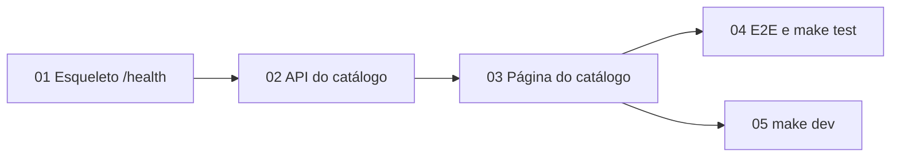

# Blueprint do Scaffolding

Quebra da [Especificação do Scaffolding](scaffolding-specification.md) em tickets verticais (tracer bullets). Cada ticket atravessa as camadas que lhe cabem, termina testado e funcionando, e atualiza o README com o que acrescenta.

## Tickets

| # | Ticket | Bloqueado por | Entrega |
| --- | --- | --- | --- |
| 01 | [Esqueleto de pé: `/health` de ponta a ponta](scaffolding/issues/01-esqueleto-health.md) | — | Monorepo, Postgres e API no compose; `/health` com 200/503; seam de integração; `make check` |
| 02 | [API do catálogo: `GET /api/products`](scaffolding/issues/02-api-catalogo.md) | 01 | Tabela de Products, serviço `migrate`, pacote `shared`, módulo `products`, envelope de erro |
| 03 | [Página do catálogo](scaffolding/issues/03-pagina-catalogo.md) | 02 | Frontend Vite + Web Components em camadas, nginx na `:8080`, testes de unidade do Domain |
| 04 | [E2E e `make test` completo](scaffolding/issues/04-e2e-make-test.md) | 03 | Playwright em container; `make test` roda os três níveis |
| 05 | [Ciclo de desenvolvimento: `make dev`](scaffolding/issues/05-make-dev.md) | 03 | Postgres + migrations + backend e Vite em watch, em paralelo |

## Grafo de dependências

## Ordem de execução

Trabalha-se a **fronteira**: qualquer ticket cujos bloqueadores estejam concluídos.

1. 01
2. 02
3. 03
4. 04 e 05 (independentes entre si; podem ser feitos em qualquer ordem ou em paralelo)

Cada ticket é implementado com `/implement` numa sessão limpa (`/clear` entre tickets), por TDD nas seams acordadas na spec, terminando com `/code-review` e um commit.

## Decisões adiadas

- O teste do `400` no envelope de erro fica para a primeira rota com entrada (feature do Cart), já que nenhuma rota do scaffolding recebe parâmetros.
